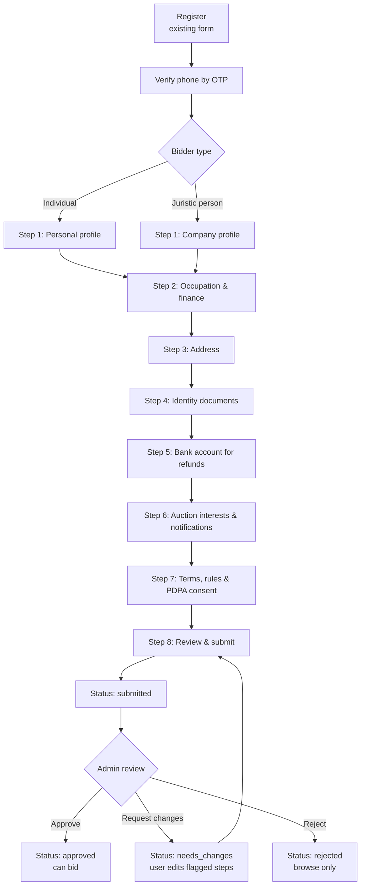

# User Onboarding Flow — Draft

Status: **Draft for review** · Last updated: 2026-11-11

## 1. Goal

After someone signs up, gather what we need to let them **bid** in an auction:

- who they are (identity / KYC)
- whether they can pay (occupation, income, source of funds)
- where to send invoices, receipts and refunds
- their consent to the auction rules and to PDPA

Users can **browse** auctions as soon as they register. They can **bid** or pay a
deposit (หลักประกัน) only after an admin approves their onboarding.

## 2. Current state (what already exists)

`RegistrationsController#create` already stores the following on `users`:

| Field | Notes |
|---|---|
| `username` | a-z, 0-9, _ · 3–30 chars · unique |
| `first_name`, `last_name` | required |
| `phone` | 10 digits, starts with 0, unique |
| `email_address` | optional |
| `password` | min 8 chars |
| `document` | one attachment (JPG/PNG/WEBP/PDF, ≤ 10MB) |

There is also OTP infrastructure (`otp_digest`, `OtpSender`), which is currently
used only for password reset.

The flow below starts **after** this registration step. Where registration
already collects a field, the user sees it pre-filled.

## 3. Flow overview



**UX rules**

- Show a progress bar (`ขั้นตอน 2 จาก 8`) on every step.
- Each step is saved when the user clicks **ถัดไป** (Next), so they can leave and
  come back. The next login returns them to their first incomplete step.
- **ย้อนกลับ** (Back) never discards data.
- A persistent banner on the home page says *"กรอกข้อมูลให้ครบเพื่อเริ่มประมูล"*
  (Complete your profile to start bidding) until the user submits.
- Mobile-first: one column, large tap targets, the numeric keypad for ID, phone
  and bank fields.

## 4. Steps in detail

`*` = required

### Step 0 — Verify phone (OTP)

- Send a 4-digit OTP to the phone number from registration, reusing `OtpSender`
  and the same TTL and attempt limits.
- Set `phone_verified_at`.
- The user can't continue until the phone is verified.

### Step 1 — Profile (ข้อมูลส่วนตัว)

First choose a **bidder type\***: บุคคลธรรมดา (individual) / นิติบุคคล (juristic person).

**Individual**

| Field | Type | Validation |
|---|---|---|
| Title* (คำนำหน้า) | select: นาย / นาง / นางสาว / อื่นๆ | |
| First name* / Last name* (TH) | text | pre-filled from registration |
| First name / Last name (EN) | text | optional, used on English documents |
| Nationality* | select | default ไทย |
| National ID* (เลขบัตรประชาชน) | 13 digits | Thai ID checksum · unique · stored encrypted |
| Passport no.* | text | required instead of the National ID if non-Thai |
| Date of birth* | date | age ≥ 20 (Thai legal age) |
| Gender | select | optional |
| Email* | email | now required, for e-receipts · pre-filled |
| Phone | — | read-only, verified in Step 0 |
| LINE ID | text | optional |
| Profile photo | image | optional |

**Juristic person**

| Field | Type | Validation |
|---|---|---|
| Company name* (TH) / (EN) | text | |
| Juristic registration no. / Tax ID* | 13 digits | checksum · unique |
| Company type* | select: บริษัทจำกัด / บมจ. / หจก. / อื่นๆ | |
| Registration date* | date | |
| VAT registered? | yes / no | if yes, add a branch code (สาขา) for tax invoices |
| Authorized person* | name, National ID, position | the person who signs for the company |
| Contact person | name, phone, email | if different from the authorized person |

### Step 2 — Occupation & finance (อาชีพและรายได้)

This step supports credit/risk screening and AML. Keep it to ranges, not exact
figures.

| Field | Type | Notes |
|---|---|---|
| Occupation* | select: พนักงานบริษัท, ข้าราชการ/รัฐวิสาหกิจ, เจ้าของกิจการ, ค้าขาย, รับเหมา, เกษตรกร, ฟรีแลนซ์, นักศึกษา, เกษียณ, อื่นๆ (ระบุ) | Individuals only |
| Employer / business name* | text | hidden for นักศึกษา / เกษียณ |
| Position | text | |
| Business type / industry* | select | e.g. รีไซเคิล/ค้าเศษวัสดุ, ขนส่ง, ก่อสร้าง, ไฟฟ้า |
| Monthly income* (individual) | range: < 15k, 15–30k, 30–50k, 50–100k, 100–300k, > 300k | |
| Annual revenue* (juristic) | range: < 1M, 1–10M, 10–50M, 50–100M, > 100M | |
| Source of funds* | multi-select: เงินเดือน, รายได้ธุรกิจ, เงินออม, สินเชื่อ, อื่นๆ | |
| Purpose of bidding* | select: ใช้เอง, ใช้ในกิจการ, ขายต่อ, รีไซเคิล | |
| Expected bid budget per auction* | range | can set the default deposit or bid limit |
| Politically exposed person (PEP)?* | yes / no | if yes, flag the account for manual review |
| Prior auction experience | yes / no + where | optional |

### Step 3 — Address (ที่อยู่)

| Field | Notes |
|---|---|
| Registered address* (ที่อยู่ตามบัตรประชาชน / ที่ตั้งสำนักงานใหญ่) | house no., moo, soi, road, **province → district → sub-district** cascading selects, postcode auto-filled |
| Contact / shipping address | checkbox "เหมือนที่อยู่ตามทะเบียน" (same as registered address) |
| Tax-invoice address | defaults to registered address |

Used for receipts, tax invoices, delivery or pickup coordination, and legal notices.

### Step 4 — Identity documents (เอกสารยืนยันตัวตน)

Upload rules are the same as today's `document` (JPG/PNG/WEBP/PDF, ≤ 10MB each),
extended to multiple named attachments.

| Bidder type | Required documents |
|---|---|
| Individual (Thai) | National ID card, front* · selfie holding the ID card* |
| Individual (foreign) | Passport photo page* · selfie holding the passport* |
| Juristic | Company affidavit (หนังสือรับรองบริษัท, issued ≤ 6 months ago)* · ภ.พ.20 (if VAT registered) · ID card of the authorized person* · power of attorney (หนังสือมอบอำนาจ) + attorney's ID if the account user is not the authorized person |

Optional extras for higher bid limits: bank statement, or proof of income for the
last 3 months.

Each upload shows a thumbnail, a re-upload button, and a reminder to cross out
the ID copy for the stated purpose only ("ใช้สำหรับการประมูลเท่านั้น").

### Step 5 — Bank account (บัญชีรับเงินคืน)

Used to refund the deposit to unsuccessful bidders.

| Field | Validation |
|---|---|
| Bank* | select (Thai banks list) |
| Account name* | must match the profile name or company name; a mismatch is flagged for review |
| Account number* | digits, 10–15 |
| Branch | optional |
| Book bank photo* (หน้าสมุดบัญชี) | image/PDF |

### Step 6 — Interests & notifications (ความสนใจ)

Optional. Can be skipped and edited later in Settings.

- **Asset categories**: ยานพาหนะ, หม้อแปลงไฟฟ้า, สายไฟ/เศษโลหะ, อุปกรณ์ไฟฟ้า,
  เครื่องจักร, ครุภัณฑ์สำนักงาน, อื่นๆ
- **Provinces / regions** where they can pick up items
- **Notification channels**: SMS, Email, LINE · events: new auction in my
  category, auction starting, outbid, won, payment due, refund sent

### Step 7 — Terms & consent (ข้อตกลงและความยินยอม)

Each item is a separate checkbox, and none is pre-ticked.

| Item | Required |
|---|---|
| Terms of use (ข้อกำหนดการใช้งาน) | ✅ |
| Auction rules: deposits, forfeiture on non-payment, payment deadline, pickup deadline, items sold as-is (สภาพตามที่เห็น) | ✅ |
| PDPA privacy notice: collection and use of personal data for identity verification and running auctions | ✅ |
| Consent to marketing communications | ❌ optional |
| Consent to share data with partners | ❌ optional |
| Declaration that all information is true (คำรับรองความถูกต้องของข้อมูล) | ✅ |

Store **which version** of each document was accepted, plus the time and IP
(`consents` table), so we can prove consent and re-prompt when a document changes.

### Step 8 — Review & submit (ตรวจสอบและยืนยัน)

- A read-only summary of every step, each with an **แก้ไข** (Edit) link that
  jumps back to that step.
- Submit → `onboarding_status = submitted`, notify the user by SMS/email
  ("ได้รับข้อมูลแล้ว จะแจ้งผลภายใน 1–2 วันทำการ"), and add the user to the admin
  review queue.

## 5. Admin review

The back-office screen lists `submitted` users, oldest first.

- View all data and documents side by side.
- Auto-checks shown as badges: ID checksum OK, duplicate ID or tax ID, age ≥ 20,
  bank name matches the profile name, PEP flag, blacklist match.
- Actions:
  - **Approve** → `approved`, optionally set a `bid_limit`.
  - **Request changes** → pick the steps and add a comment. The user gets a
    notification and only the flagged steps unlock.
  - **Reject** with a reason.
- Every action goes to an audit log (who, when, what, reason).

## 6. Account statuses and permissions

| `onboarding_status` | Browse | Watchlist | Pay deposit / Bid |
|---|---|---|---|
| `in_progress` | ✅ | ✅ | ❌ |
| `submitted` | ✅ | ✅ | ❌ |
| `needs_changes` | ✅ | ✅ | ❌ |
| `approved` | ✅ | ✅ | ✅ (up to `bid_limit`) |
| `rejected` | ✅ | ✅ | ❌ |
| `suspended` (e.g. forfeited deposit / didn't pay) | ✅ | ❌ | ❌ |

If the user changes **identity or bank data** after approval, status goes back to
`submitted`. Other edits, such as interests or the contact address, take effect
immediately.

## 7. Proposed data model

```text
users                      (existing)
  + bidder_type            enum: individual, juristic
  + onboarding_status      enum (see §6), default in_progress
  + onboarding_step        integer, last completed step
  + phone_verified_at      datetime
  + submitted_at, approved_at, approved_by_id
  + bid_limit              decimal, nullable

user_profiles              1:1 users — Step 1 & 2 fields
  national_id / tax_id     encrypts deterministic: true  (allows unique index)
  passport_no              encrypts
  date_of_birth, title, names (TH/EN), nationality
  company fields (juristic), authorized_person_*
  occupation, employer, industry, income_range, source_of_funds[], purpose,
  budget_range, is_pep

addresses                  N:1 users — kind: registered | contact | tax_invoice

bank_accounts              N:1 users — bank_code, account_name, account_number (encrypted), verified_at

attachments                via Active Storage named attachments on user_profiles:
                           id_card_front, selfie_with_id, company_affidavit,
                           vat_certificate, power_of_attorney, book_bank

user_interests             categories[], provinces[], notify_channels[]

consents                   user_id, kind, document_version, accepted_at, ip_address, revoked_at

onboarding_reviews         user_id, reviewer_id, action, steps_flagged[], comment, created_at
```

Implementation notes:

- Use Rails 8 `encrypts` for the national ID, passport and bank account number,
  and mask them in the UI and API (`x-xxxx-xxxxx-12-3`).
- One controller per step (`Onboarding::ProfilesController`, …), or a single
  `OnboardingController` with a `step` param. Each step validates only its own
  fields, using validation contexts such as `on: :profile_step`.
- Add a `require_approved_bidder` `before_action` for the bidding and deposit
  endpoints.
- Mirror the steps in `api/v1` so a mobile app can reuse them.

## 8. Open questions

1. Do we support **foreign** bidders in phase 1, or Thai nationals and Thai juristic persons only?
2. Is manual admin approval acceptable, or do we need e-KYC (NDID, DOPA ID-card check) for instant approval?
3. Should income or budget drive an automatic `bid_limit`, or is it informational only?
4. Can one person act for several companies, so one login is linked to several juristic profiles?
5. Who owns the PDPA notice and the auction rules text, and how are versions published?
6. What is the target SLA for admin review?
7. Is the bank account needed at onboarding, or only before the first deposit? Deferring it would shorten onboarding.
